I'm a GTM engineer. Most days I build the automation that fills a sales pipeline: leads come in, get enriched and scored by AI, land in the CRM, and outreach goes out on its own. The rest of the time I build products. 45+ so far, across apps, games, AI agents and websites.

**[Work with me](https://growbig100.com)** &nbsp;/&nbsp; [Portfolio](https://omar3d-lyoljt.manus.space/) &nbsp;/&nbsp; [All projects](https://github.com/omark-dev/projects)

## Selected work

<table>
  <tr>
    <td colspan="2">
      
       <b>VantageFit AI.</b> A gym trainer that runs in the browser. The camera counts your reps and grades each one on depth, tempo and alignment.
    </td>
  </tr>
  <tr>
    <td width="50%" valign="top">
      
       <b>Guardian Shrine.</b> A Roblox pet game. Hatch guardians, evolve them, protect the shrine.
    </td>
    <td width="50%" valign="top">
      
       <b>Black Pearl.</b> One board to watch a fleet of AI agents plan, draft and post.
    </td>
  </tr>
</table>

| Also built | What it does | Status |
|---|---|---|
| AI agent team | Agents that scout leads, draft LinkedIn posts and report in Slack, around the clock | Live |
| Subscription-based apps | 15+ news, finance and game apps on one shared login and billing platform | Live |
| Ad Factory | Turns a script into a finished vertical video ad: voices, shots, edit, captions | Built |
| Holo Control | Runs two monitors by hand, eyes and voice, fully offline | Built |
| Klevora Host | Minecraft server hosting site with a 3D island you can mine | Built |

## How I fill a pipeline

**Outbound automation.** Lead sourcing, enrichment and multi-step sequences that run without anyone pushing them. 
**AI agents.** Agents that research a prospect, qualify them and write the first message. 
**CRM and data ops.** Clean records, tools that sync, no duplicates, reports people actually read.

I work in n8n, Claude, OpenAI, Python, TypeScript, PHP, React, Flutter and Supabase. For games and video: Roblox, Godot, Phaser, Remotion and Blender.

---

Want your go-to-market on autopilot? **[Work with me →](https://growbig100.com)**
